# NEXVAULT — Warehouse Management & Slot Allocation System

> **Full-Stack Project** · Node.js · Express 5 · MongoDB Atlas · Mongoose · JWT · Nodemailer · Vanilla JavaScript · HTML5 · CSS3

**Live Demo:** [Open NexVault](https://nexvault-warehouse.vercel.app/)

---

## 1. Problem Statement

Companies running multiple warehouses need to place incoming stock efficiently, track occupancy across sites in real time, and make sure different types of users — company admins, warehouse supervisors, and the platform team that runs the whole system — only see and touch what's relevant to their role.

NexVault is an end-to-end warehouse management and slot optimization platform covering four connected areas:

- **Authentication & onboarding** — role-based sign in and company registration with MongoDB persistence and JWT security
- **Warehouse floor** — a live slot map with an automatic allocation engine and real-time MongoDB synchronization, run by supervisors
- **Company ledger** — a company-wide oversight and requisition dashboard for company admins
- **Platform console** — an internal governance tool for the NexVault team to approve, reject, or delete client companies and warehouses

---

## 2. Solution Overview

NexVault pairs a high-performance **Node.js & Express REST API** connected to **MongoDB Atlas** with a responsive frontend built in **HTML, CSS and Vanilla JavaScript**. It features:

- Role-based authentication (`company-admin`, `supervisor`, `platform-admin`) backed by bcrypt password hashing and JWT
- Transactional email dispatch via Nodemailer / SMTP for account approvals, slot assignments, and rejections
- Cloud database persistence with Mongoose models for companies, warehouses, slots, inventory items, and allocation logs
- A first-fit-decreasing slot allocation algorithm driven by item dimensions, weight, fragility, and pick velocity
- An optimizer flagging rack pressure, overfill, waiting stock, and travel-time inefficiencies
- Platform administration console with the ability to approve accounts, auto-provision rack grids, or delete pending/declined records
- Real-time client-to-cloud synchronization keeping warehouse floors updated without manual reloading

---

## 3. Features

### Authentication & Onboarding
- ✅ Role-based Sign In (Company Admin / Supervisor / Platform Admin)
- ✅ Organization email and password validation
- ✅ Invalid credential and pending-approval handling
- ✅ Company registration form with duplicate-email detection
- ✅ Minimum password length and confirm-password checks
- ✅ New companies stored with `pending` status
- ✅ Registration reference generation and animated success screen
- ✅ Client-side session creation and role-based redirection

### Warehouse Floor (Supervisor)
- ✅ Passcode-gated access, one passcode per warehouse
- ✅ Live rack/slot occupancy view with search and filters (all / near-full / has-space)
- ✅ Stock in — automatic slot allocation, no manual slot picking
- ✅ Stock out — removal with automatic reallocation of anything queued
- ✅ Optimizer with four live checks: rack pressure, overfill, waiting units, travel time
- ✅ Zone-level utilization reports and a running activity log
- ✅ 3D view placeholder (not yet built)

### Company Ledger (Company Admin)
- ✅ Read-only, live view of every warehouse the company runs
- ✅ Utilization stats: active sites, pending requests, average utilization, total slots, units waiting
- ✅ Site filtering (all / over 65% full / under 40% full)
- ✅ Warehouse addition requests and removal requests, sent to the platform team
- ✅ Live updates via the browser's `storage` event when a supervisor changes stock in another tab

### Platform Console (Platform Admin)
- ✅ Queue of company sign-ups, with approve/decline actions
- ✅ Queue of warehouse open/removal requests, with approve/decline actions
- ✅ Approving a warehouse request builds a real rack plan, issues a passcode, and adds the site to the live directory
- ✅ Read-only table of every site on the platform, across every client company

### UI / UX
- ✅ Responsive layouts on every page
- ✅ Animated slot-utilization percentages and progress bars
- ✅ Role selection banner on Sign In
- ✅ Form-level and field-level error states
- ✅ Loading / verification states on buttons
- ✅ Reduced-motion support
- ✅ Mobile-friendly layouts throughout

---

## 4. Technology Stack

| Layer | Technology |
|---|---|
| **Backend Runtime** | Node.js (v18+) |
| **Backend Framework** | Express 5 |
| **Database** | MongoDB Atlas / Mongoose ODM |
| **Authentication & Security** | JSON Web Tokens (`jsonwebtoken`), `bcryptjs`, `google-auth-library` |
| **Email & Notifications** | Nodemailer (SMTP with Ethereal / production SMTP) |
| **Frontend Structure** | HTML5 Semantic Markup |
| **Frontend Styling** | CSS3 (Custom design system + CSS variables) |
| **Frontend Logic** | Vanilla JavaScript (ES6+ modular code) |
| **UI Framework** | Bootstrap 5.3.3 (auth pages only) |
| **Fonts** | Google Fonts — Space Grotesk & Inter |
| **Browser APIs** | Fetch API, DOM API, URLSearchParams, `storage` event, `requestAnimationFrame`, `performance.now()` |
| **Version Control** | Git / GitHub |
| **Deployment** | Vercel (Frontend) · Render / Railway (Backend) |

---

## 5. Backend REST API Endpoints

The NexVault server exposes **23 RESTful API endpoints** across 4 functional domains. All JSON responses adhere to a consistent `{ success: boolean, ... }` envelope format.

| Domain | Base Path | Endpoints | Purpose |
|---|---|:---:|---|
| **System & Health** | `/` | 2 | Root service catalog & MongoDB automated health check |
| **Authentication** | `/api/auth` | 5 | Company registration, JWT login, Google OAuth SSO & profile |
| **Platform Administration** | `/api/admin` | 6 | Company approval queue, slot provisioning, deletions & stats |
| **Warehouse Operations** | `/api/warehouse` | 10 | CE2 slot allocation algorithm, inventory transfers, removals & state sync |
| **Total** | | **23** | |

---

### 5.1 System & Health

| Method | Endpoint | Description | Access |
|---|---|---|---|
| `GET` | `/api` | Root status endpoint returning service metadata and catalog. | Public |
| `GET` | `/api/health` | Automated health check reporting uptime and MongoDB connection state (`connected`, `connecting`, `disconnected`). | Public |

```bash
# Example Health Check Response
curl http://localhost:5001/api/health
```
```json
{
  "status": "healthy",
  "service": "NexVault Backend",
  "timestamp": "2026-10-27T15:00:00.000Z",
  "uptimeSeconds": 1420,
  "database": "connected"
}
```

---

### 5.2 Authentication (`/api/auth`)

Manages client company registration, role-based login, Google Single Sign-On, and JWT validation.

| Method | Endpoint | Description | Request Body / Parameters | Access |
|---|---|---|---|---|
| `POST` | `/api/auth/register` | Register a new client company account with `pending` status. | `{ companyName, contactName, workEmail, warehouseCount, password }` | Public |
| `POST` | `/api/auth/login` | Authenticate `company-admin`, `supervisor`, or `platform-admin`; returns JWT. | `{ email, password, role }` | Public |
| `POST` | `/api/auth/google` | Google OAuth SSO token verification and automatic onboarding. | `{ credential, role }` | Public |
| `GET` | `/api/auth/google/client-id` | Retrieve public Google OAuth client ID for frontend button initialization. | *None* | Public |
| `GET` | `/api/auth/me` | Fetch active user profile and authorized company details. | *Bearer Token in Authorization Header* | Private (JWT) |

```bash
# Login Example
POST /api/auth/login
Content-Type: application/json

{
  "email": "ops@harborbell.com",
  "password": "warehouse123",
  "role": "company-admin"
}
```

---

### 5.3 Platform Administration & Governance (`/api/admin`)

Used by the NexVault Platform Admin console ([`platform-admin.html`](platform-admin.html)) to govern company registrations, auto-provision facility rack maps, and maintain system queues.

| Method | Endpoint | Description | Request Body / Parameters | Access |
|---|---|---|---|---|
| `GET` | `/api/admin/companies` | List all client company registrations across `pending`, `approved`, and `rejected` states. | *None* | Platform Admin |
| `POST` | `/api/admin/companies/decide` | Approve or decline a company registration. Approving auto-builds 32-slot rack maps and dispatches an SMTP notification email. | `{ email, decision: "approved"\|"rejected", reason? }` | Platform Admin |
| `PUT` | `/api/admin/companies/:identifier/decide` | Alternative path parameter endpoint to approve or reject a company. | Path `:identifier` (ID or email), Body `{ decision, reason? }` | Platform Admin |
| `DELETE` | `/api/admin/companies/:identifier` | Permanently delete a pending or rejected company registration. | Path `:identifier` (MongoDB `_id` or email) | Platform Admin |
| `DELETE` | `/api/admin/companies` | Alternative delete endpoint accepting identifier in request body. | `{ identifier }` or `{ email }` | Platform Admin |
| `GET` | `/api/admin/stats` | Summary statistics of total, pending, and approved client companies. | *None* | Platform Admin |

```bash
# Company Approval Example
POST /api/admin/companies/decide
Content-Type: application/json

{
  "email": "ops@harborbell.com",
  "decision": "approved"
}
```

---

### 5.4 Warehouse Operations & Optimization Engine (`/api/warehouse`)

Executes inventory allocation algorithms, slot management, stock transfers, and warehouse state synchronization.

| Method | Endpoint | Description | Request Body / Parameters | Access |
|---|---|---|---|---|
| `POST` | `/api/warehouse/allocate` | **CE2 Core Packing Algorithm**: Inbounds inventory items, evaluates dimensions, weight, fragility, and pick velocity, and allocates optimal slots. | `{ warehouseId, items: [{ sku, name, width, height, length, weight, quantity, handling, velocity }] }` | Private |
| `POST` | `/api/warehouse/transfer` | Move inventory units from a source slot to a destination slot. | `{ warehouseId, sourceSlotId, targetSlotId, sku, quantity }` | Private |
| `POST` | `/api/warehouse/remove` | Outbound stock removal; picks items from slot and updates capacity. | `{ warehouseId, slotId, sku, quantity }` | Private |
| `POST` | `/api/warehouse/rename` | Update the display name of a warehouse. | `{ warehouseId, name }` | Private |
| `POST` | `/api/warehouse/reset` | Clear all inventory units and reset warehouse slots to vacant. | `{ warehouseId }` | Private |
| `POST` | `/api/warehouse/sync` | Persist live floor layout, rack structures, and slots from client to MongoDB Atlas. | `{ warehouseId, companyName, racks }` | Private |
| `GET` | `/api/warehouse/company/:companyName` | Fetch all warehouses belonging to a specific company. | Path `:companyName` | Private |
| `GET` | `/api/warehouse/slots/:warehouseId` | Retrieve live slot occupancy, volume, weight, and status for a warehouse. | Path `:warehouseId` | Private |
| `GET` | `/api/warehouse/allocations/:warehouseId` | Query historical batch allocation audit records and placement logs. | Path `:warehouseId` | Private |
| `GET` | `/api/warehouse/:warehouseId` | Fetch complete warehouse model including rack layout directly from MongoDB Atlas. | Path `:warehouseId` | Private |

```bash
# Allocate Stock Example
POST /api/warehouse/allocate
Content-Type: application/json

{
  "warehouseId": "WH-01",
  "items": [
    {
      "sku": "SKU-ELEC-01",
      "name": "Industrial Sensor",
      "width": 20,
      "height": 15,
      "length": 30,
      "weight": 5,
      "quantity": 10,
      "handling": "fragile",
      "velocity": "fast"
    }
  ]
}
```

---

## 6. Architecture

```text
                         USER
                           |
                           v
                    LANDING PAGE
                           |
                           v
                    ROLE SELECTION
                           |
                           v
                    +--------------+
                    | Sign In Page |
                    +--------------+
                           |
                    Selected Role
                           |
             +-------------+-------------+
             |             |             |
             v             v             v
        Company Admin  Supervisor   Platform Admin
             |             |             |
             v             v             v
      Company Ledger  Warehouse    Platform Console
      (read-only)     Select →         (approvals)
                       Floor
```

Each destination page reads from the same shared warehouse data defined in `js/floor.js` — nothing is duplicated per role.

---

## 7. Authentication Flow

```text
User selects role
       |
       v
Role stored / retrieved
       |
       v
User opens Sign In
       |
       v
Enter email + password
       |
       v
Validate form
       |
       +----------------+
       |                |
    Invalid            Valid
       |                |
       v                v
 Show error       POST /api/auth/login
                        |
                 +------+------+
                 |             |
               Invalid        Valid
                 |             |
                 v             v
            Show error    Save JWT & Session
                               |
                               v
                       Redirect by role
```

The selected role can be obtained from the URL query string or from browser storage, with `company-admin` used as the fallback role.

---

## 8. Role-Based Access

| Role | Entry point | Destination | Purpose |
|---|---|---|---|
| `company-admin` | `signin.html?role=company-admin` | `company-dashboard.html` | Company-level warehouse oversight, view only |
| `supervisor` | `signin.html?role=supervisor` | `warehouse-select.html` → `warehouse-floor.html` | Passcode-gated warehouse access, stock control |
| `platform-admin` | `signin.html?role=platform-admin` | `platform-admin.html` | Approving companies and warehouse requests |

The role is also displayed on the Sign In card so the user can see which access type was selected.

---

## 9. Storage & Session Architecture

NexVault implements a hybrid architecture: MongoDB Atlas is the persistent cloud system of record, while client storage (`localStorage` & `sessionStorage`) maintains the authenticated session and powers zero-latency cross-tab live synchronization.

| Key | Purpose |
|---|---|
| `nexvault-jwt` | Bearer JSON Web Token for authenticated REST API requests |
| `nexvault-session` | Currently authenticated user profile (`role`, `email`, `company`) |
| `nexvault-role` | Role selected on the landing page / Sign In pills |
| `nexvault-warehouse-<ID>` | Client-side cached slot map for a specific warehouse |
| `nexvault-active-warehouse` | Which warehouse a supervisor currently has open |
| `nexvault-unlocked` | Passcode-gate unlock state for the active warehouse |
| `nexvault-warehouse-requests` | Queue of open/delete warehouse requests |
| `nexvault-approved-warehouses` | Warehouses created via an approved request |
| `nexvault-removed-warehouses` | Warehouses removed via an approved deletion |

---

## 10. Default Accounts & Credentials

### Platform Admin
```text
Email:    admin@nexvault.internal
Password: nexvault2026
Role:     platform-admin
```

### Sample Seeded Company
```text
Company:  Harbor & Bell Logistics
Email:    ops@harborbell.com
Password: warehouse123
Status:   approved
```

Pre-configured demo warehouses:

| ID | City | Passcode | Slots |
|---|---|---|---|
| `WH-01` | Manesar Hub | `1101` | 32 (Expandable) |
| `WH-02` | Neemrana Facility | `1102` | 32 (Expandable) |
| `WH-04` | Bhiwadi Depot | `1104` | 32 (Expandable) |

---

## 11. Credential Verification & Security

Authentication is secured on the backend via Express and MongoDB:
1. **Password Hashing**: Passwords are encrypted before storage using `bcryptjs` with salt rounds.
2. **Account Status Verification**: Accounts with status `pending` or `rejected` are prevented from signing in.
3. **JWT Generation**: Authenticated users receive a signed JWT token containing user identity and company affiliation.
4. **Google OAuth 2.0**: Supports seamless Single Sign-On using Google Identity Services.

---

## 12. Sign In & Client Validation

The Sign In form validates organization email and password. On submit, JavaScript prevents the default browser submission, checks both fields, and sends authentication requests to `/api/auth/login`.

If validation fails: the invalid field gets an error style, the first invalid field receives focus, and the form does not submit.

If validation succeeds: the button switches to a "verifying" state while credentials are authenticated against MongoDB Atlas.

---

## 13. Company Registration Flow

```text
Register Company → Enter Details → Validate Fields → Validate Email
    → Check Password Length → Confirm Password Match
    → Check Duplicate Email → Create Company (status: "pending")
    → Save to MongoDB Atlas → Success Screen
```

| Check | Result |
|---|---|
| Empty field | Registration rejected |
| Invalid email | Registration rejected |
| Password shorter than 6 characters | Registration rejected |
| Passwords do not match | Registration rejected |
| Email already registered | Registration rejected |
| All data valid | Registration accepted, status = `pending` |

---

## 14. Company Approval Workflow

```text
Company Registration → Pending → Platform Admin Review → Approved → Company Can Sign In
```

A `pending` company cannot sign in until a platform admin approves it from the Platform Console.

---

## 15. Registration Success Screen

After a successful registration:
- Displays the registered company name
- Generates a registration reference in the format `OV-YEAR-RANDOMNUMBER` (e.g. `OV-2026-4827`)
- Plays an animated grid-clear transition before revealing the confirmation message
- Links back to the main site and to Sign In

---

## 16. Warehouse Floor & Slot Allocation Engine

This is the core of the project, implemented in `js/floor.js` and supported by `/api/warehouse/allocate` in `warehouseController.js`.

### How a unit gets placed
1. Incoming stock (dimensions, weight, quantity, pick velocity, fragile flag) is expanded into individual units.
2. Each unit is checked against every slot's remaining volume and weight capacity.
3. Fragile items are isolated — they only go into a slot of their own.
4. Remaining valid slots are ranked by matching pick velocity to distance from the dock: fast movers are pushed toward slots near the dock, slow movers toward slots deep in the warehouse.
5. If nothing fits, the unit is placed into a **waiting-for-space** queue instead of failing outright.

### Removing stock
Freeing a slot automatically triggers `runReallocation()`, which retries every unit sitting in the waiting queue against the newly available space.

### The Optimizer
Recalculated from the live slot map on every change — nothing is hardcoded. It runs four checks:

| Check | What it flags |
|---|---|
| Rack pressure | Any rack over 90% full, with the nearest rack that still has room |
| Overfill | Any slot over 92% full, grouped per rack |
| Waiting units | Stock that couldn't be placed, retried automatically once space frees |
| Travel time | Fast movers sitting far from the dock while a nearer slot could accept them |

### Reports
Zone-level utilization (racks grouped and ordered by distance from the dock) plus a running activity log of every placement, removal, and reallocation.

---

## 17. Company Ledger

`company-dashboard.html` / `js/admin.js` give a company admin a **read-only** view across every warehouse their company runs.

- Every figure (utilization, occupied slots, units waiting) is summed live from each warehouse's own slot map — there is no separate copy of the data.
- Company admins can file two kinds of requests to the platform team: **add a warehouse** or **remove a warehouse**. Neither action happens instantly; both stay `pending` until the platform admin decides.
- The `storage` event keeps this page updated automatically the moment a supervisor changes stock on the floor page, even in a different browser tab.

---

## 18. Platform Console

`platform-admin.html` / `js/platform.js` is the internal governance tool for the NexVault team:

- **Company queue** — approve, decline, or delete new registrations. A declined or still-pending company cannot sign in.
- **Warehouse request queue** — approving an *addition* request actually builds a new rack plan, generates a passcode, and adds the site to `WAREHOUSE_DIRECTORY`, so it immediately appears in the company's ledger and the supervisor's warehouse picker. Approving a *removal* request takes the site out of the directory.
- **Request & Account Deletion** — interactive **Delete** button allowing platform admins to permanently delete pending or declined company accounts and warehouse requests.
- **All Sites table** — a read-only list of every warehouse running on the platform, across every client company.

---

## 19. Warehouse Utilization Animation

Slot cards on the auth pages carry a target percentage:
```html
<div class="scard" data-target="92">
```
JavaScript reads it via `card.dataset.target` and animates the percentage and bar fill using `setTimeout()`, `performance.now()`, `requestAnimationFrame()`, and an easing function — creating a live-feeling warehouse visualization on page load. This respects `prefers-reduced-motion`.

---

## 20. UI Design

Each role has a distinct visual language, all sharing the same underlying conventions:

- **Auth pages** — cream background, off-white cards, terracotta accent, Space Grotesk headings, Inter body text, graph-paper background.
- **Company ledger** — warm paper theme, Georgia serif typography.
- **Platform console** — plainer, darker, internal-tool aesthetic, Arial/system sans-serif.
- **Warehouse floor** — neutral cream workspace theme matching the auth pages' tone.

Shared conventions across all of them: rounded/square cards depending on role, thin borders, minimal shadows, and a dedicated `:focus-visible` state for keyboard navigation.

---

## 21. Responsive Design

### Desktop
```text
+-----------------------------------------------+
| Header                                        |
+-----------------------------------------------+
| Main content area                             |
| (varies by page — two-column on auth pages,   |
| grid layouts on ledger/console pages)         |
+-----------------------------------------------+
```

### Mobile
All multi-column layouts collapse to single-column below ~900px (auth pages break slightly earlier at ~960px). The password-confirmation pair on the registration page also stacks vertically on small screens.

---

## 22. Accessibility & UX

- Semantic form labels and correct HTML input types
- `autocomplete` attributes set deliberately per field (including disabling it where autofill would cause UI conflicts, e.g. the numeric warehouse passcode field)
- Error messages exposed via `role="alert"`
- Focus automatically moves to the first invalid field on a failed validation
- Visible keyboard focus states (`:focus-visible`) throughout
- Reduced-motion support on every animated element
- Disabled/loading button states during verification and submission

---

## 23. Folder Structure

NexVault follows a clean, modular full-stack architecture. The backend adopts an MVC service pattern with Express and Mongoose, while the frontend sits cleanly at the root level:

```text
NexVault/
│
├── config/                    ← Database and external service initializers
│   ├── db.js                  ← MongoDB Atlas connection via Mongoose
│   └── nodemailer.js          ← SMTP email transporter configuration
│
├── controllers/               ← Core business logic and algorithm execution
│   ├── adminController.js     ← Platform admin approvals, stats & company deletions
│   ├── authController.js      ← Authentication, password comparison & JWT signing
│   └── warehouseController.js ← Slot packing algorithm, stock transfers & removals
│
├── models/                    ← Mongoose schemas and data models
│   ├── Company.js             ← Client company accounts & warehouse records
│   ├── Slot.js                ← Warehouse physical slots, coordinates & capacities
│   ├── Item.js                ← Cargo items stored inside slots
│   └── Allocation.js          ← Historical placement logs & audit trail
│
├── routes/                    ← Express REST API endpoints
│   ├── adminRoutes.js         ← /api/admin platform administration endpoints
│   ├── authRoutes.js          ← /api/auth registration, login & JWT validation
│   └── warehouseRoutes.js     ← /api/warehouse allocation, slots & state sync
│
├── utils/                     ← Shared utility services
│   └── emailService.js        ← HTML email templates & SMTP mail sender
│
├── scripts/                   ← Standalone CLI utilities and test suites
│   ├── test-workflow.js       ← End-to-end governance lifecycle test (npm test)
│   └── seed-warehouse.js      ← Initial database seed script (npm run db:seed)
│
├── css/                       ← Modular UI styling
│   ├── styles.css             ← Landing page
│   ├── sigin.css              ← Sign In / Sign Up
│   ├── floor.css              ← Warehouse floor & 3D view
│   ├── admin.css              ← Company ledger
│   └── platform.css           ← Platform console
│
├── js/                        ← Frontend client scripts
│   ├── api-config.js          ← Dynamic backend API base URL resolver
│   ├── script.js              ← Landing page interactions
│   ├── sigin.js               ← MongoDB auth integration & session setup
│   ├── floor.js               ← Slot allocation engine & live sync
│   ├── select.js              ← Warehouse picker (supervisor)
│   ├── admin.js               ← Company ledger dashboard
│   └── platform.js            ← Platform admin console & deletion controls
│
├── index.html                 ← Landing page
├── signin.html                ← Role-based sign-in
├── signup.html                ← Company registration
├── warehouse-select.html      ← Facility picker for supervisors
├── warehouse-floor.html       ← Live physical slot map & inventory controls
├── warehouse-3d.html          ← 3D isometric warehouse visualization
├── company-dashboard.html     ← Company admin governance ledger
├── platform-admin.html        ← Platform admin internal console
├── server.js                  ← Express server entry point
└── README.md
```

**Load order matters** — `floor.js` must load before any page-specific script that depends on it:
```html
<script src="js/floor.js"></script>
<script src="js/admin.js"></script>
```

---

## 24. Cross-Tab Live Sync

The company ledger and platform console listen for the browser's native `storage` event, which fires in *other* tabs whenever LocalStorage changes in *one* tab. This is how a supervisor placing stock on the floor page instantly updates the company admin's utilization numbers in a different tab without polling.

---

## 25. Security & Authentication Architecture

NexVault implements industry-standard security safeguards:
- **Password Encryption**: All passwords hashed using `bcryptjs` before persisting to MongoDB Atlas.
- **Stateless Authorization**: JSON Web Tokens (JWT) signed with secret keys, verified on protected endpoints.
- **Role-Based Access Control (RBAC)**: Enforces boundaries between `platform-admin`, `company-admin`, and `supervisor`.
- **Sanitized Deletions**: Platform Admin can only delete pending or declined companies; companies with live warehouses are protected against accidental deletion.
- **CORS Protection**: Whitelisted origin handling in Express for local and production Vercel/Render deployments.

---

## 26. How to Run

### Prerequisites
- [Node.js](https://nodejs.org/) (v18.0.0 or higher)
- [MongoDB Atlas](https://www.mongodb.com/atlas) connection URI (or local MongoDB)

### Installation & Local Setup

1. **Clone the repository**:
   ```bash
   git clone https://github.com/Sakshamv511/NexVault.git
   cd NexVault
   ```

2. **Install dependencies**:
   ```bash
   npm install
   ```

3. **Configure Environment Variables**:
   Create a `.env` file in the root directory:
   ```env
   PORT=5001
   MONGODB_URI=mongodb+srv://<username>:<password>@cluster0.mongodb.net/nexvault?retryWrites=true&w=majority
   JWT_SECRET=your_jwt_secret_key_here
   PLATFORM_ADMIN_EMAIL=admin@nexvault.internal
   PLATFORM_ADMIN_PASSWORD=nexvault2026
   FRONTEND_URL=http://localhost:5001
   SMTP_HOST=smtp.ethereal.email
   SMTP_PORT=587
   SMTP_USER=your_user
   SMTP_PASS=your_pass
   ```

4. **Seed Initial Database (Optional)**:
   ```bash
   npm run db:seed
   ```

5. **Run the Development Server**:
   ```bash
   npm run dev
   # or
   npm start
   ```
   Open `http://localhost:5001` in your browser.

6. **Run Automated End-to-End Tests**:
   ```bash
   npm test
   ```

---

## 27. Application Flow

```text
Landing Page
     |
     +-------------------+
     |                   |
     v                   v
   Sign In          Register Company
     |                   |
     v                   v
Role Selection      Registration Form → Validation → Pending → Success Screen
     |
     v
Credentials → Verification → Create Session
     |
     +----------------+----------------+
     v                v                v
Company Ledger   Warehouse Picker  Platform Console
(view-only)       → Passcode →         (approvals)
                    Floor
```

---

## 28. Application Flow Screenshots

The screenshots below follow the main user journey through NexVault, from the landing page and authentication to warehouse operations, company oversight, and platform administration.

### 28.1 Landing & Authentication

| Step | Screen |
|---|---|
| 1 | **Landing Page — Light Theme** |
| 2 | **Landing Page — Dark Theme** |
| 3 | **How It Works** |
| 4 | **Role Selection** |
| 5 | **Company Registration** |
| 6 | **Unified Role-Based Sign In & Google SSO** |

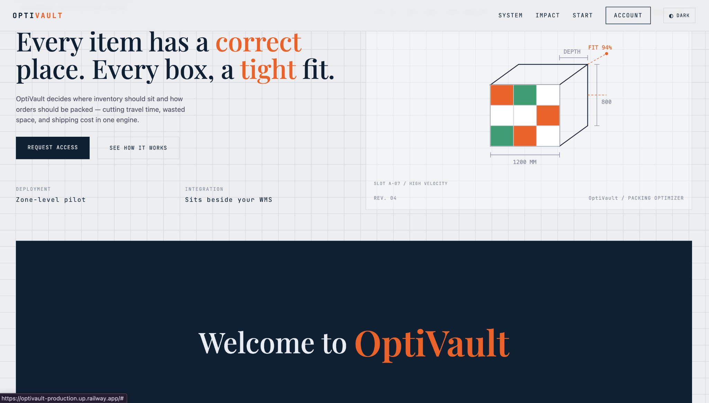

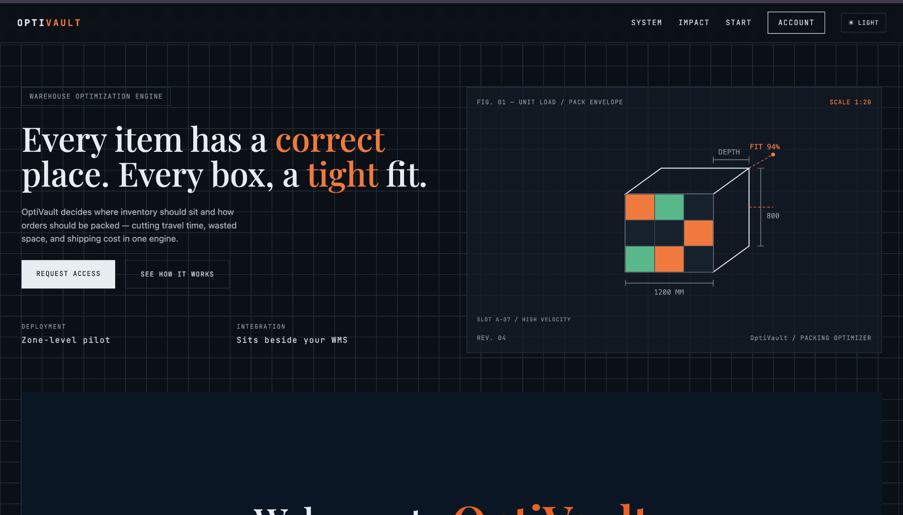

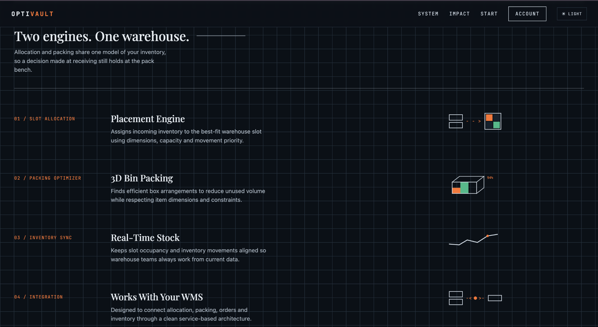

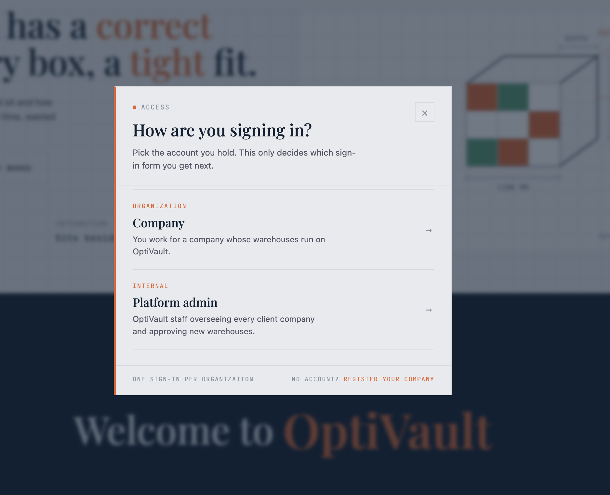

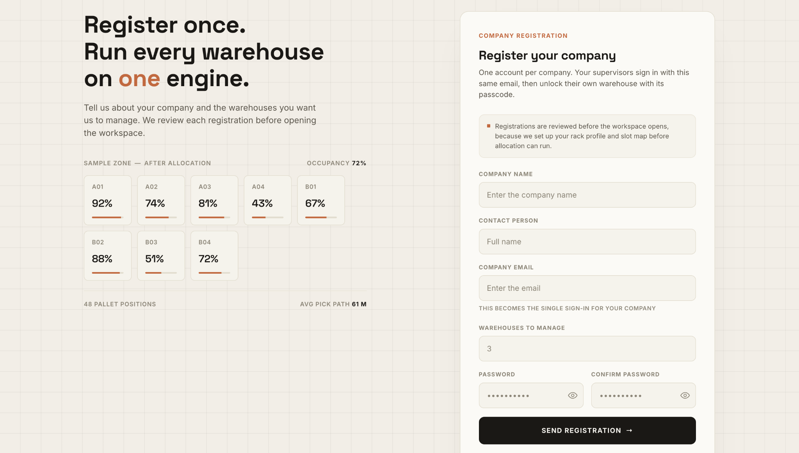

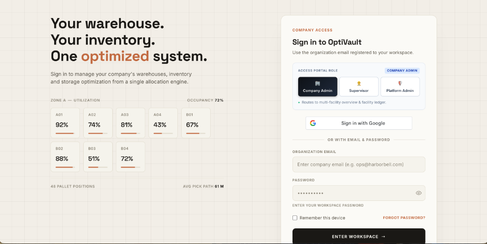

### 28.2 Supervisor / Warehouse Flow

**Supervisor → Select Warehouse → Enter Passcode → Warehouse Floor (32 Slots) → Live Inventory**

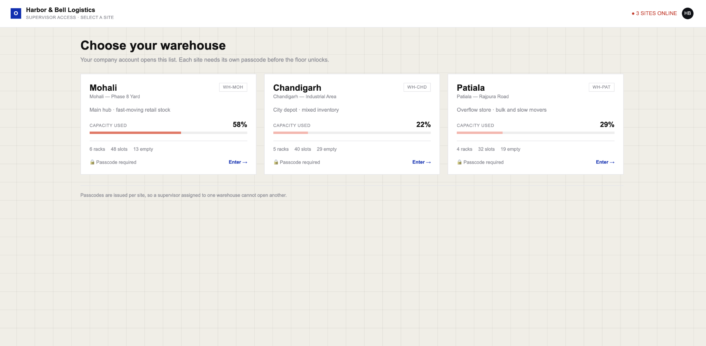

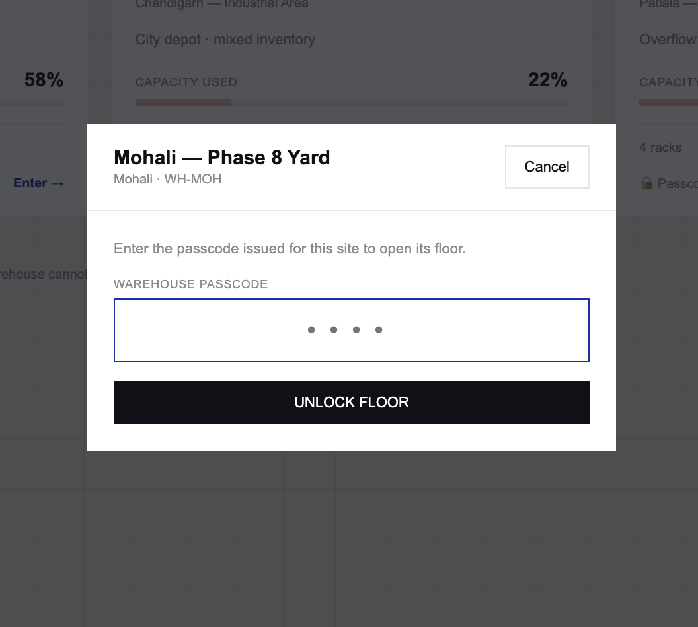

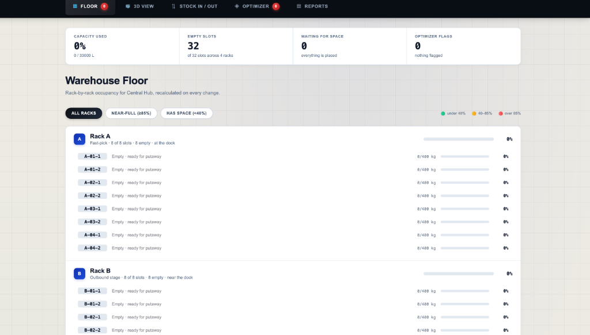

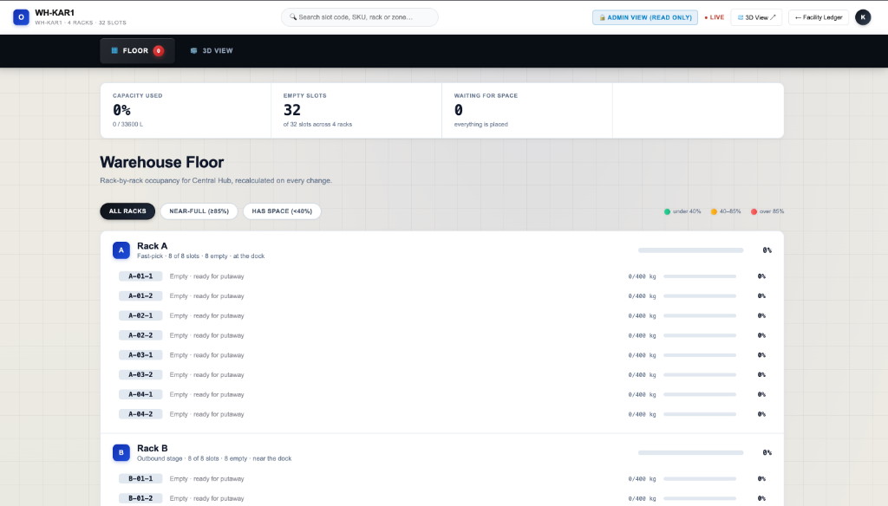

### 28.3 Company Admin Flow

**Company Admin → Multi-Facility Ledger → Provisioning Queue**

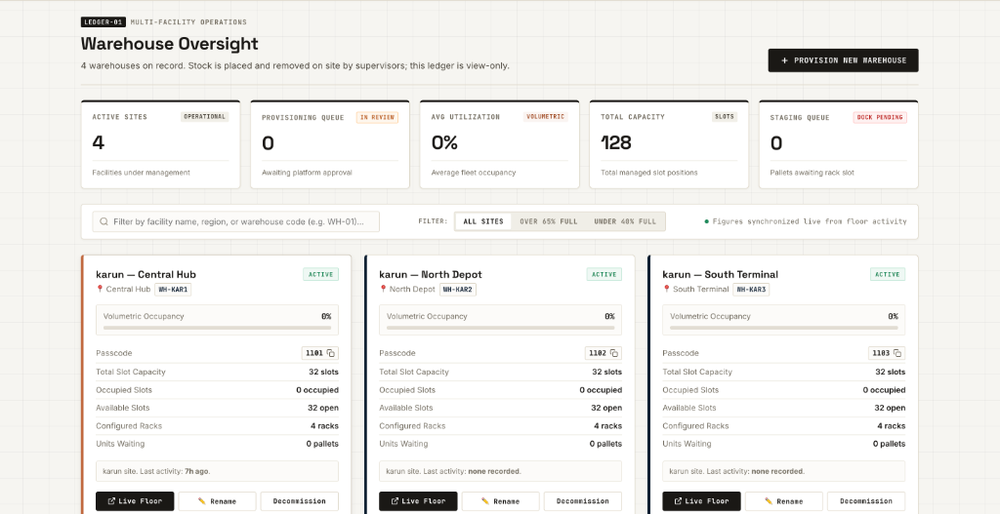

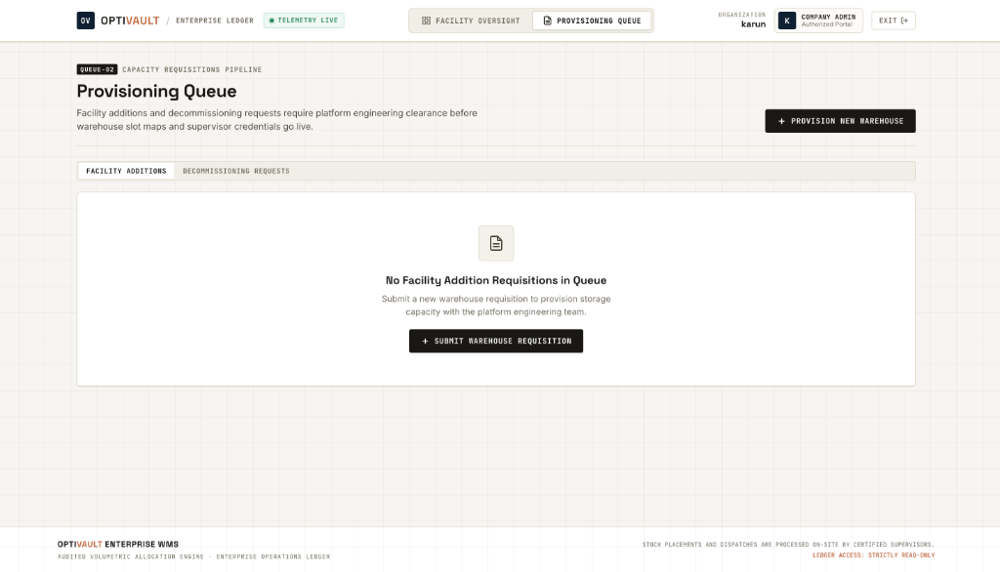

### 28.4 Platform Admin Flow

**Platform Admin → Warehouse Requests / Companies / All Sites**

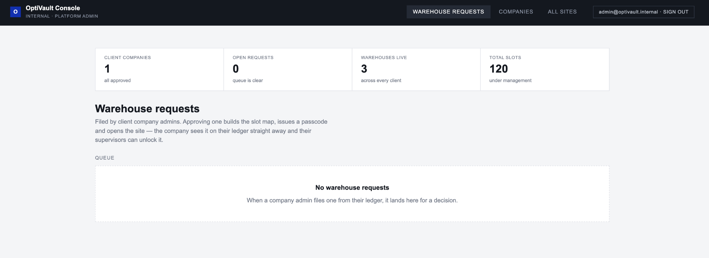

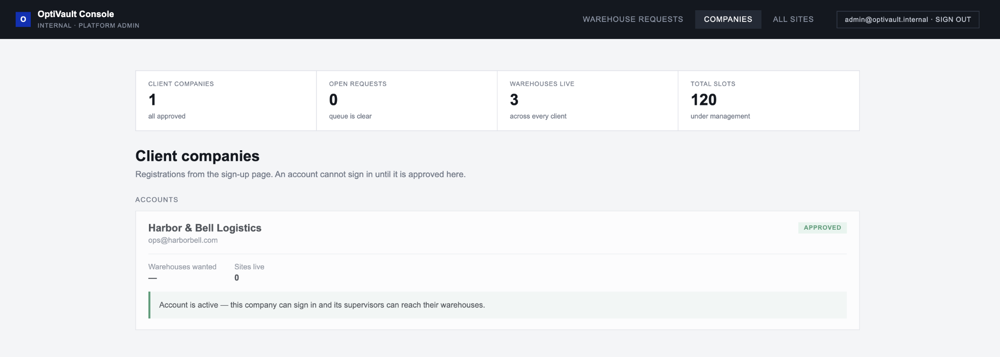

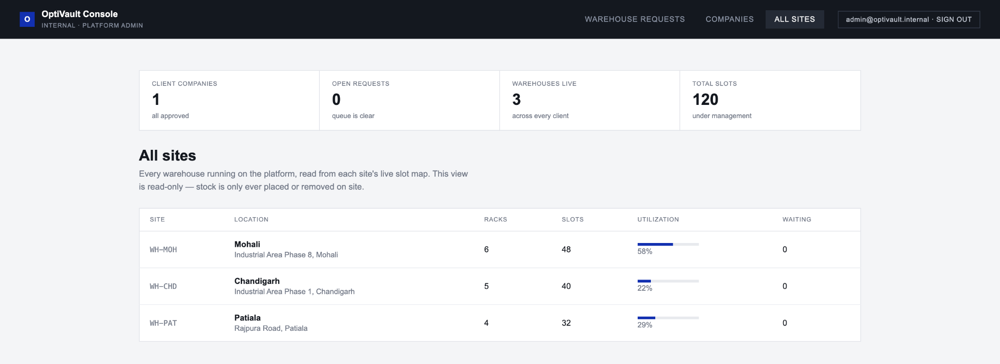

### 28.5 3D Spatial Visualization

**Interactive 360° Isometric Physical Rack Geometry & Real-time Slot Occupancy**

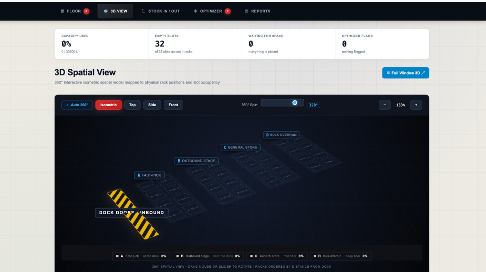

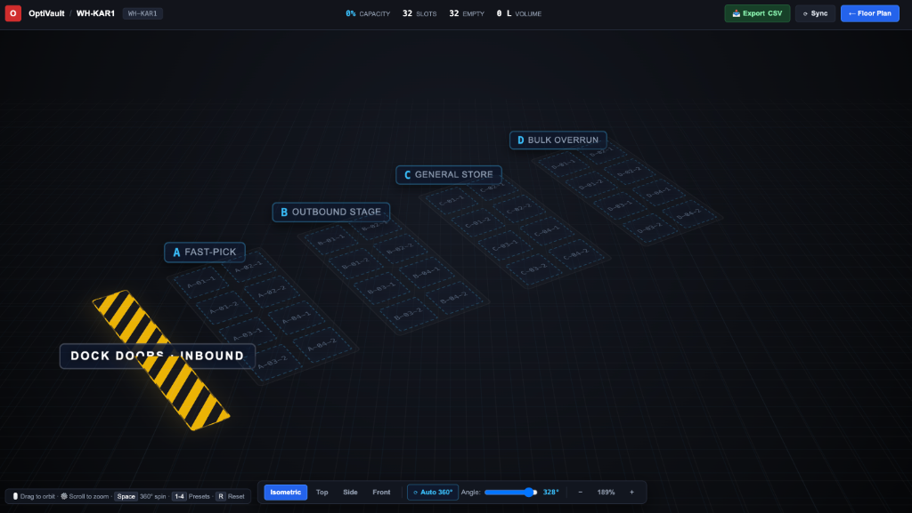

---

## 29. Git Workflow

```bash
git pull origin main
git add .
git commit -m "feat: implement authentication and company registration"
git push origin main
```

| Prefix | Purpose |
|---|---|
| `feat:` | New feature |
| `fix:` | Bug fix |
| `style:` | CSS / UI changes |
| `refactor:` | Code restructuring |
| `docs:` | Documentation |
| `chore:` | Maintenance |

---

## 30. Key Concepts Demonstrated

```text
Node.js & Express 5 → MongoDB Atlas & Mongoose Models → JWT Authentication & Bcrypt Hashing
→ SMTP Transactional Mailer → Dynamic API Base URL Resolution → First-Fit Packing Algorithm
→ 3D Isometric View → Cross-Tab Live Sync → Role-Based Access Control
```

---

## 31. Project Scope

```text
USER ONBOARDING + AUTHENTICATION + ROLE IDENTIFICATION + SESSION CREATION
        +
SLOT ALLOCATION + PACKING OPTIMIZATION + LIVE OPTIMIZER FLAGS
        +
COMPANY-WIDE OVERSIGHT (READ-ONLY LEDGER)
        +
PLATFORM-LEVEL APPROVAL WORKFLOW (COMPANIES + WAREHOUSES)
```

---

> **NEXVAULT — Warehouse Management & Slot Allocation System**
>
> *A frontend simulation of a multi-tenant warehouse platform: authentication, live slot allocation, company oversight, and platform administration — built entirely on HTML, CSS, Vanilla JavaScript, and LocalStorage.*


---

## 31. Backend API Reference

NexVault's backend API is hosted at:

**Base URL:** `https://nexvault-backend.onrender.com`

Use these endpoints in Thunder Client or another API client. For requests with JSON payloads, set `Content-Type: application/json` and select **Body → JSON**. Replace placeholders such as `COMPANY_IDENTIFIER`, `COMPANY_NAME`, and `WAREHOUSE_ID` with actual values. URL-encode company names that contain spaces.

### General API

| Method | Endpoint | Description |
|---|---|---|
| `GET` | `/api/health` | Checks whether the backend is running and reports the MongoDB connection state. |
| `GET` | `/api` | Returns the API name, version, status, and available API groups. |

### Authentication API

| Method | Endpoint | Description |
|---|---|---|
| `POST` | `/api/auth/register` | Registers a company with `pending` status. |
| `POST` | `/api/auth/login` | Checks credentials and returns a JWT when login succeeds. |
| `POST` | `/api/auth/google` | Verifies a Google sign-in credential; requires a real Google ID token. |
| `GET` | `/api/auth/google/client-id` | Returns the Google OAuth client ID configured on the backend. |
| `GET` | `/api/auth/me` | Returns the profile for the authenticated user. Requires `Authorization: Bearer YOUR_JWT_TOKEN`. |

**Register company — `POST /api/auth/register`**
```json
{
  "companyName": "Demo Logistics",
  "contactName": "Test User",
  "workEmail": "demo@example.com",
  "warehouseCount": 2,
  "password": "DemoPass123"
}
```

**Login — `POST /api/auth/login`**
```json
{
  "email": "demo@example.com",
  "password": "DemoPass123",
  "role": "company-admin"
}
```

**Google sign-in — `POST /api/auth/google`**
```json
{
  "credential": "GOOGLE_ID_TOKEN",
  "role": "company-admin",
  "requestedWarehouses": 1,
  "companyName": "Demo Logistics"
}
```

Use a new test email when registering. A placeholder Google token will not authenticate.

### Platform Admin API

| Method | Endpoint | Description |
|---|---|---|
| `GET` | `/api/admin/companies` | Lists company registrations and their statuses (`pending`, `approved`, `rejected`). |
| `POST` | `/api/admin/companies/decide` | Approves or rejects a company registration. Approval creates company warehouse/slot records. |
| `PUT` | `/api/admin/companies/COMPANY_IDENTIFIER/decide` | Updates a company decision. Replace the identifier with the company's email or MongoDB ID. |
| `DELETE` | `/api/admin/companies/COMPANY_IDENTIFIER` | Deletes a pending/rejected registration if it has no warehouse records. |
| `GET` | `/api/admin/stats` | Returns total, pending, and approved company counts. |

**Decide company — `POST /api/admin/companies/decide`**
```json
{
  "email": "demo@example.com",
  "decision": "approved"
}
```

For rejection, use `"decision": "rejected"` and optionally include `"reason"`.

**Update company decision — `PUT /api/admin/companies/COMPANY_IDENTIFIER/decide`**
```json
{
  "decision": "approved"
}
```

The `DELETE` endpoint does not require a request body. Use it only with a disposable test registration and verify that the route has been merged and deployed before testing.

### Warehouse API — Read Data

| Method | Endpoint | Description |
|---|---|---|
| `GET` | `/api/warehouse/company/COMPANY_NAME` | Returns warehouses belonging to a company. |
| `GET` | `/api/warehouse/WAREHOUSE_ID` | Returns the warehouse floor model, including racks and slots. |
| `GET` | `/api/warehouse/slots/WAREHOUSE_ID` | Returns warehouse slots, capacity, and occupancy. |
| `GET` | `/api/warehouse/allocations/WAREHOUSE_ID` | Returns recent allocation history for a warehouse. |

Examples:
- `/api/warehouse/company/Demo%20Logistics`
- `/api/warehouse/WH-MOH`
- `/api/warehouse/slots/WH-MOH`
- `/api/warehouse/allocations/WH-MOH`

### Warehouse API — Stock Operations

| Method | Endpoint | Description |
|---|---|---|
| `POST` | `/api/warehouse/allocate` | Allocates incoming stock to suitable slots using the server-side allocation algorithm. |
| `POST` | `/api/warehouse/remove` | Removes a quantity of an SKU from a specific slot. |
| `POST` | `/api/warehouse/transfer` | Moves stock between slots, checking destination capacity and constraints. |
| `POST` | `/api/warehouse/rename` | Changes a warehouse name and optionally its city. |
| `POST` | `/api/warehouse/sync` | Synchronizes rack and slot state from the frontend to MongoDB. |
| `POST` | `/api/warehouse/reset` | Resets every slot in a warehouse to vacant and clears stored units. |

**Allocate stock — `POST /api/warehouse/allocate`**
```json
{
  "warehouseId": "WH-MOH",
  "companyName": "Demo Logistics",
  "item": {
    "sku": "DEMO-API-001",
    "name": "Storage Box",
    "l": 30,
    "w": 20,
    "h": 10,
    "weight": 5,
    "velocity": "fast",
    "fragile": false,
    "qty": 2
  }
}
```

**Remove stock — `POST /api/warehouse/remove`**
```json
{
  "warehouseId": "WH-MOH",
  "slotId": "A-01-1",
  "sku": "DEMO-API-001",
  "quantity": 1
}
```

**Transfer stock — `POST /api/warehouse/transfer`**
```json
{
  "warehouseId": "WH-MOH",
  "fromSlotId": "A-01-1",
  "toSlotId": "B-01-1",
  "sku": "DEMO-API-001",
  "quantity": 1
}
```

**Rename warehouse — `POST /api/warehouse/rename`**
```json
{
  "warehouseId": "WH-MOH",
  "newName": "Central Warehouse",
  "newCity": "Chandigarh"
}
```

**Sync warehouse — `POST /api/warehouse/sync`**
```json
{
  "warehouseId": "WH-MOH",
  "companyName": "Demo Logistics",
  "racks": [
    {
      "id": "A",
      "name": "Rack A",
      "zone": "General store",
      "distanceFromDock": 1,
      "slots": [
        {
          "id": "A-01-1",
          "maxVolume": 800,
          "maxWeight": 400,
          "units": []
        }
      ]
    }
  ]
}
```

**Reset warehouse — `POST /api/warehouse/reset`**
```json
{
  "warehouseId": "WH-MOH"
}
```

### API Testing and Safety Notes

- Use test company details and a unique demo SKU such as `DEMO-API-001`.
- Allocation, removal, transfer, sync, reset, company-decision, and `DELETE` requests can modify live records.
- **Destructive operation:** do not call `/api/warehouse/reset` against production unless you intend to clear all stored stock in that warehouse.
- `GET /api/auth/me` requires a JWT Bearer token.
- Google sign-in requires a real Google ID token.
- Do not assume the platform-admin routes are protected unless server-side authorization has been implemented and deployed. The endpoint reference specifically warns that the current admin routes may not have platform-admin authentication.
- If the company `DELETE` endpoint fails on the live service, confirm that the change is on `main` and that Render has deployed the latest commit.
